<span style="font-family: 'Roboto', monospace; font-size: 16px;">

# Mockup

### Test page:
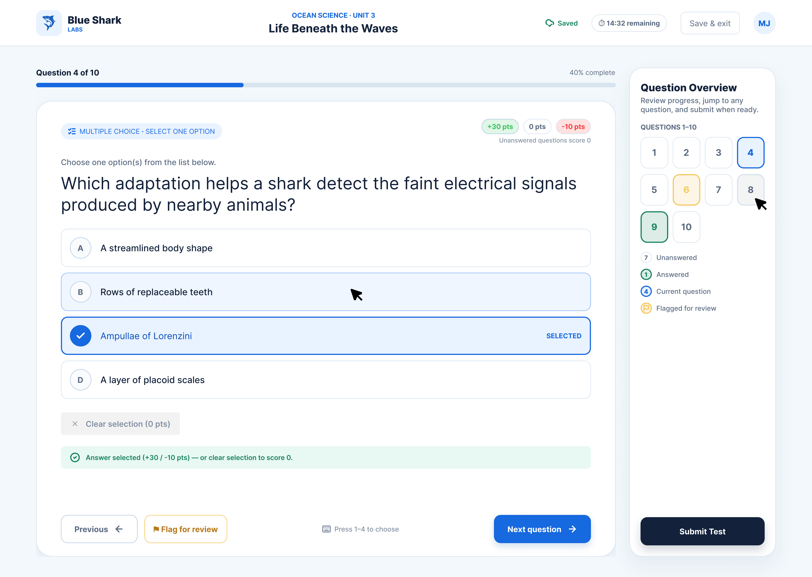
 
# Logo

Blue shark labs logo:


# Colour Palette

We chose a sea theme, to reflect Weston's coastal history:

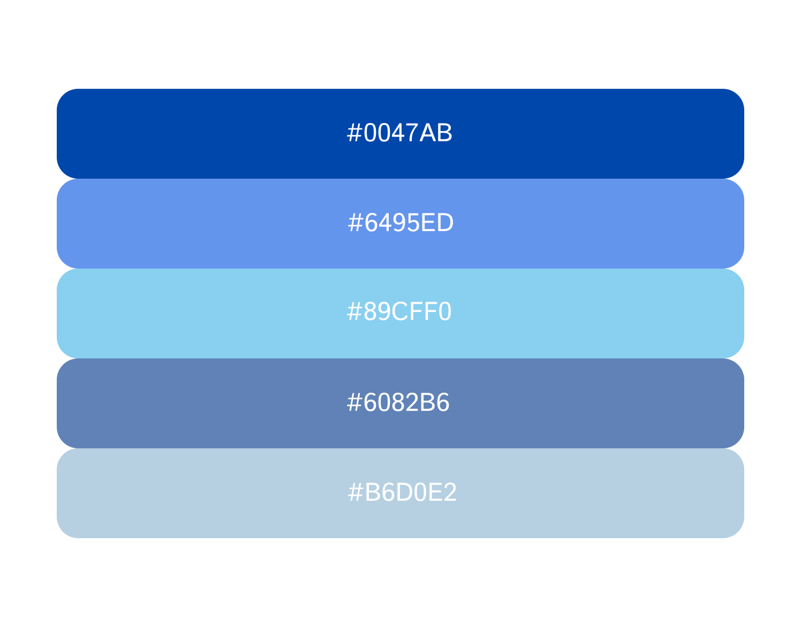

The associated Hex Codes for these colours are:
```
#0047AB
#6495ED
#89CFF0
#6082B6
#B6D0E2
```
Colours #0047AB, #6082B6, #B6D0E2 have been chosen to match the WCAG 2.2 AA requirements of 4.5:1 contrast ratio when paired with either white text or black text, white text for dark colours, black text for light colours. The other 2 colours are there for variety within the UI, but will not have text on top of them.

# Entity Relationship Diagram (ERD)

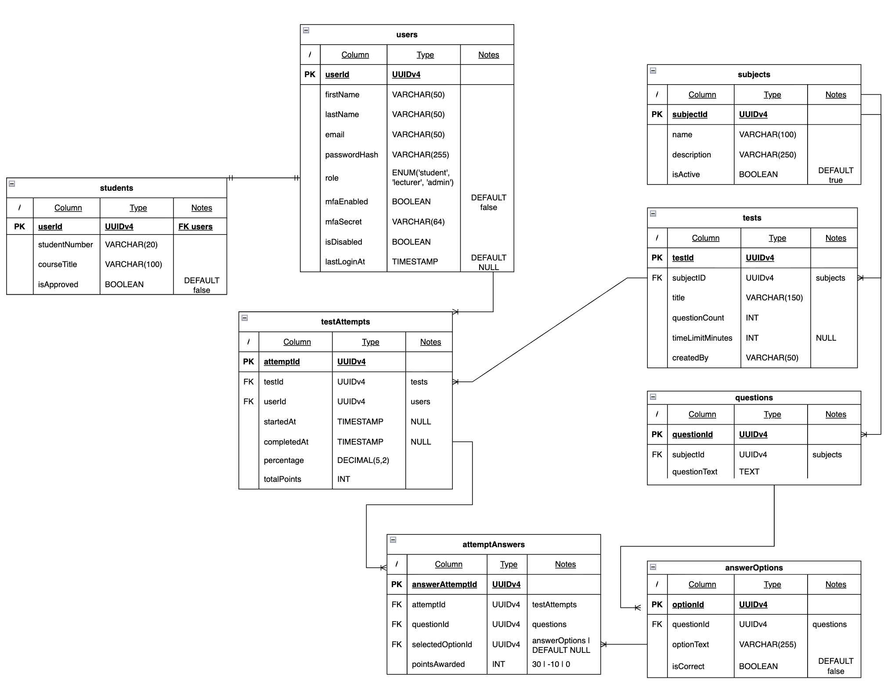

# Font

### Roboto

This is the HTML code to get the chosen roboto font into our website
```
<link rel="preconnect" href="https://fonts.googleapis.com">
<link rel="preconnect" href="https://fonts.gstatic.com" crossorigin>
<link href="https://fonts.googleapis.com/css2?family=Roboto:ital,wght@0,100..900;1,100..900&display=swap" rel="stylesheet">
```
Alternatively, the CSS to get roboto into our website is:
```
.roboto-<uniquifier> {
  font-family: "Roboto", sans-serif;
  font-optical-sizing: auto;
  font-weight: <weight>;
  font-style: normal;
  font-variation-settings:
    "wdth" 100;
}
```
# REST Endpoints

Proposed API surface derived from the platform requirements (landing page, auth, student registration, student dashboard). Registration, approval, rejection, and test assignment are explicit action routes for clarity; MFA/password-reset deferred to a later phase.

## MVP endpoints

### Auth

| Method | Endpoint | Description |
|---|---|---|
| `POST` | `/api/auth/login` | Single login for all roles |
| `POST` | `/api/auth/logout` | Invalidate current session/token |

### Users (students, lecturers, admins)

| Method | Endpoint | Description |
|---|---|---|
| `POST` | `/api/users/register` | Student self-registration (public; creates `role=student`, `status=pending`) |
| `GET` | `/api/users?role=&status=` | List/filter users (e.g., lecturer viewing pending students) |
| `GET` | `/api/users/{id}` | Get a user's profile |
| `PATCH` | `/api/users/{id}` | Update a user's profile fields (role-gated) |
| `POST` | `/api/users/{id}/approve` | Lecturer approves a pending student registration |
| `POST` | `/api/users/{id}/reject` | Lecturer rejects a pending student registration |
| `DELETE` | `/api/users/{id}` | Deactivate/delete a user (admin-only) |

### Tests

| Method | Endpoint | Description |
|---|---|---|
| `GET` | `/api/tests` | List tests visible to the authenticated user (assigned tests for students, authored tests for lecturers) |
| `POST` | `/api/tests` | Create a test (lecturer-only) |
| `PATCH` | `/api/tests/{id}` | Update a test's own fields (lecturer-only) |
| `POST` | `/api/tests/{id}/assign` | Assign a test to one or more students (lecturer-only) |
| `DELETE` | `/api/tests/{id}` | Delete a test (lecturer-only) |

### Questions

| Method | Endpoint | Description |
|---|---|---|
| `GET` | `/api/questions` | List question bank |
| `POST` | `/api/questions` | Create a question (lecturer-only) |
| `PATCH` | `/api/questions/{id}` | Update a question (lecturer-only) |

### Attempts

| Method | Endpoint | Description |
|---|---|---|
| `POST` | `/api/tests/{id}/attempts` | Student starts an attempt |
| `PATCH` | `/api/tests/{id}/attempts/{attempt_id}` | Submit/update answers, or fetch result via `GET` |

### Pages (server-rendered)

| Method | Endpoint | Description |
|---|---|---|
| `GET` | `/` | Landing page ([home.py](../rest/home.py)) |
| `GET` | `/login` | Login page (single form for all roles) |
| `GET` | `/register` | Student registration page |
| `GET` | `/dashboard` | Student dashboard - test selection |
| `GET` | `/tests/{id}` | Test-taking page for an active attempt |
| `GET` | `/lecturer/dashboard` | Lecturer dashboard - pending approvals, test/question management |

## Post MVP (additional functionality)

| Method | Endpoint | Description |
|---|---|---|
| `POST` | `/api/auth/mfa/challenge` | Send OTP (email/SMS/authenticator app) |
| `POST` | `/api/auth/mfa/verify` | Verify OTP to complete login |
| `POST` | `/api/auth/password/forgot` | Request password reset |
| `POST` | `/api/auth/password/reset` | Complete password reset with token |

## Notes

- Role-based access (`student`, `lecturer`, `admin`) enforced per-endpoint in the REST layer per this repo's clean-architecture convention (REST → use cases → database).
- `DELETE` on questions omitted from MVP — question bank items are typically soft-retired (e.g., `status=archived` via `PATCH`) rather than hard-deleted once used in a test.

</span>

# Key Flowcharts

## 1. Guest Landing → Auth Entry

Covers FR-01 to FR-04.

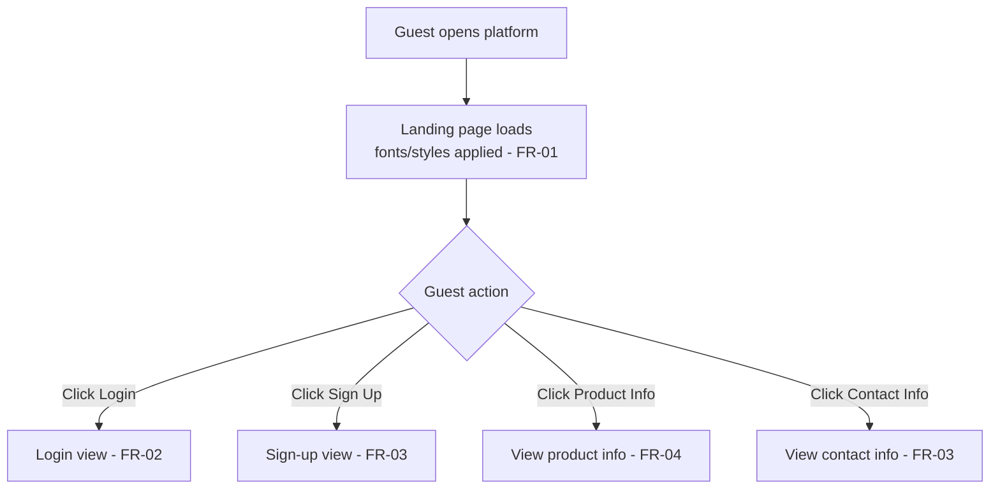

## 2. Authentication & Session Flow

Covers FR-05 to FR-11, FR-012, NFR-03, NFR-05, NFR-06.

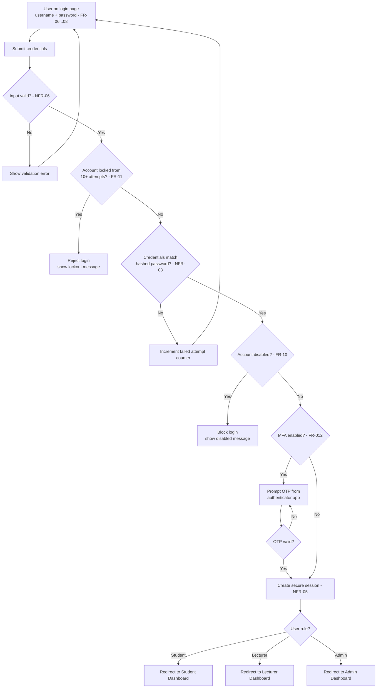

### Pseudocode - login attempt handling

```text
INPUT Username, Password, OtpCode

IF Username OR Password IS INVALID THEN
    WRITE "Invalid input"
    RETURN
END IF

IF Account IS LOCKED OUT THEN
    WRITE "Too many attempts, try again later"
    RETURN
END IF

READ User RECORD WHERE Username MATCHES Username

IF User DOES NOT EXIST OR Password DOES NOT MATCH StoredHash THEN
    WRITE "Invalid credentials"
    CALL RecordFailedAttempt
    RETURN
END IF

IF User IS DISABLED THEN
    WRITE "Account disabled"
    RETURN
END IF

IF User HAS MFA ENABLED THEN
    IF OtpCode IS INVALID THEN
        WRITE "Invalid OTP"
        RETURN
    END IF
END IF

CALL CreateSecureSession WITH User
CALL ClearFailedAttempts WITH Username
OUTPUT RedirectToDashboard WITH User Role
```

## 3. Student Sign-Up & Lecturer Approval

Covers FR-13 to FR-15.

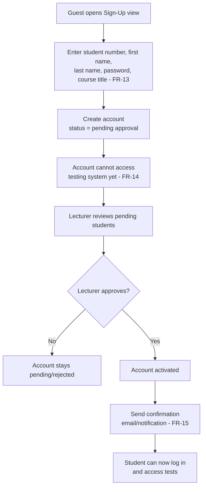

## 4. Sign-Out Flow

Covers FR-55, FR-56.

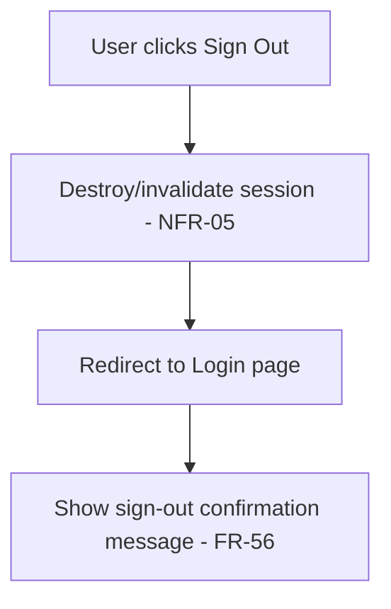

## 5. Student Test-Taking Flow

Covers FR-15 to FR-25.

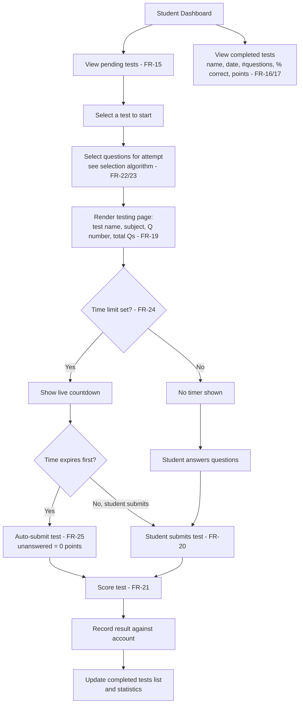

### Pseudocode - question selection (FR-22, FR-23)

```text
INPUT Student, Subject, PoolSize

SET QuestionPool TO ALL QUESTIONS FOR Subject
SET SelectedQuestions TO EMPTY LIST

IF PrioritiseWeakQuestions FEATURE IS ENABLED THEN
    SET WeakQuestions TO QUESTIONS Student FREQUENTLY GETS WRONG FROM QuestionPool
    SET SelectedQuestions TO RANDOM SUBSET OF WeakQuestions UP TO PoolSize
END IF

WHILE SIZE OF SelectedQuestions IS LESS THAN PoolSize
    SET RemainingQuestions TO QuestionPool MINUS SelectedQuestions
    ADD ONE RANDOM QUESTION FROM RemainingQuestions TO SelectedQuestions
ENDWHILE

SHUFFLE SelectedQuestions
OUTPUT SelectedQuestions
```

### Pseudocode - scoring & submission (FR-20, FR-21, FR-25)

```text
INPUT Attempt, Answers, AutoSubmitted

SET Score TO 0

FOR EACH Question IN Attempt Questions
    SET Answer TO MATCHING ENTRY IN Answers FOR Question

    IF Answer IS MISSING THEN
        SET Points TO 0
    ELSE IF Answer IS CORRECT THEN
        SET Points TO 30
    ELSE
        SET Points TO -10
    END IF

    ADD Points TO Score
END FOR

SET PercentCorrect TO CORRECT ANSWERS DIVIDED BY TOTAL QUESTIONS TIMES 100

WRITE Result RECORD WITH Student, Test, Score, PercentCorrect, CompletedAt, AutoSubmitted
OUTPUT Result
```

### Pseudocode - countdown/auto-submit timer (FR-24, FR-25)

```text
INPUT Attempt

IF Attempt Test HAS NO TIME LIMIT THEN
    RETURN
END IF

SET Deadline TO Attempt StartedAt PLUS Test TimeLimitMinutes

WHILE CURRENT TIME IS BEFORE Deadline
    SET RemainingTime TO Deadline MINUS CURRENT TIME
    OUTPUT RemainingTime TO Countdown Display
    WAIT ONE SECOND
ENDWHILE

CALL SubmitTest WITH Attempt, CurrentAnswers, AutoSubmitted SET TO TRUE
```

## 6. Student Results, Leaderboard & Export

Covers FR-26 to FR-31.

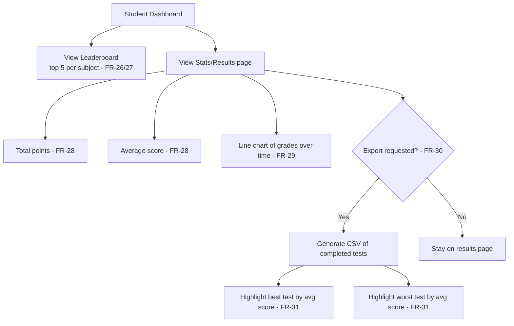

## 7. Lecturer - Student Management

Covers the lecturer FR block (list/approve/edit/disable/delete students, progress monitoring).

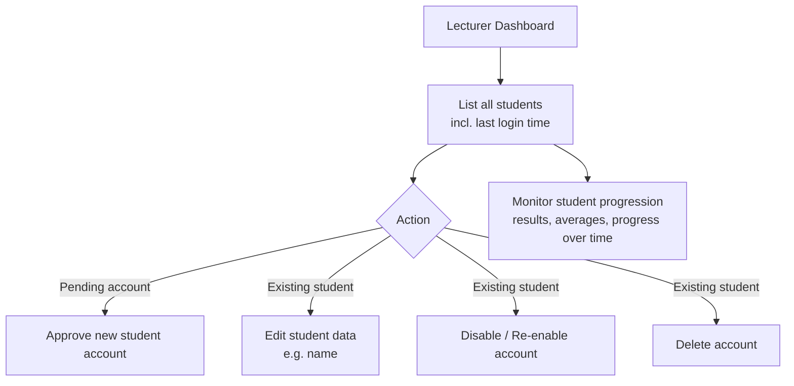

## 8. Lecturer - Test & Question Management

Covers lecturer test-creation FR block.

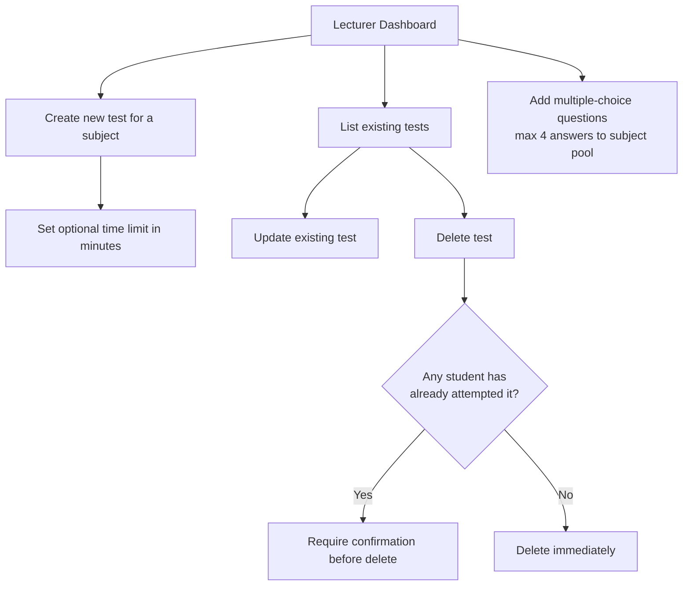

## 9. Admin - Subjects & Lecturer Accounts

Covers FR-46 to FR-55.

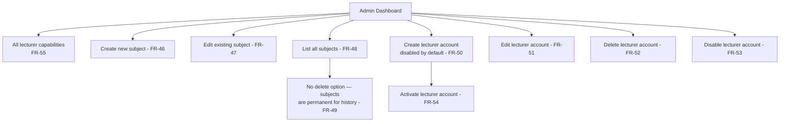

## 10. Role-Based Access Control (cross-cutting)

Covers NFR (RBAC) applied to every request.

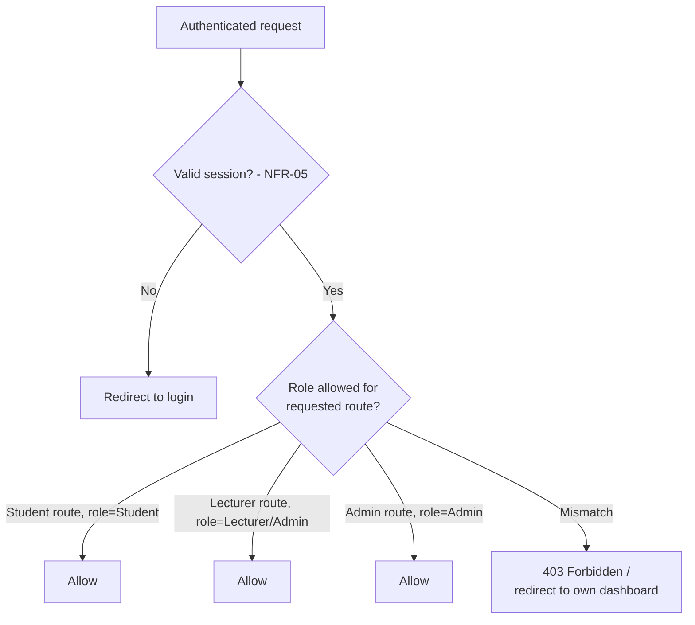